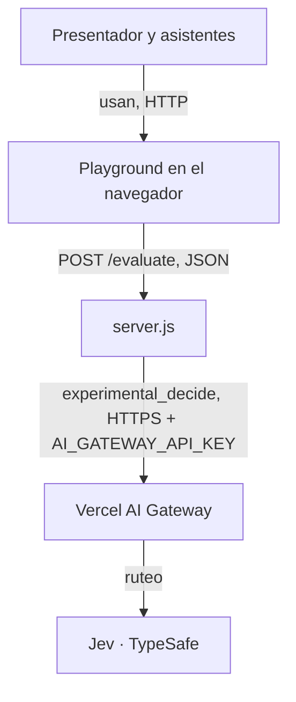
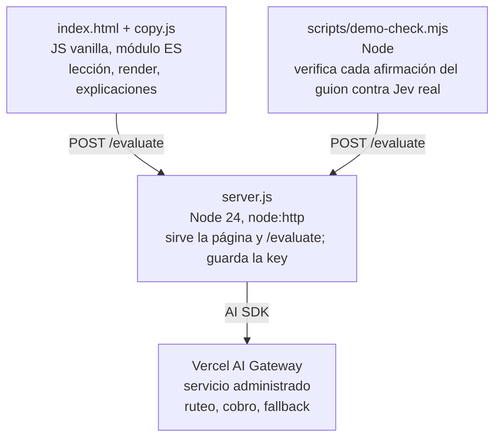

# Evaluar con Jev — Arquitectura

**Estado:** planeado (describe el diseño elegido; el README describe lo construido) · **Fecha:** 2026-10-24

## Summary
El server Node que ya existe guarda la key y llama a Jev por Vercel AI Gateway con el AI SDK, y la página vanilla solo habla con ese server; se sube `ai` para usar `experimental_decide` y `/evaluate` pasa a devolver la confianza de TypeSafe. Acepta depender de una API marcada `experimental_*` a cambio de enseñar el mismo SDK que los devs usan para LLMs.

## Drivers
| ID | Atributo | Escenario (fuente, estímulo, entorno, respuesta) | Medida | De |
|---|---|---|---|---|
| QA-01 | Seguridad | Un asistente abre las herramientas del navegador durante la charla y busca la key | 0 apariciones de la key en lo que sirve el server (`index.html`, `copy.js`) | R6 |
| QA-02 | Rendimiento | El presentador aprieta "Preguntarle a Jev" en un paso de práctica, en vivo | menos de 3 s por respuesta; medido: p50 292 ms, máx. 595 ms en 18 llamadas (S3) | R11, R12 |
| QA-03 | Mantenibilidad | Un asistente copia el snippet del último paso y lo corre con la versión actual de `ai` | corre sin warnings de deprecación con `ai@7.0.153` (S1) | R15 |
| QA-04 | Corrección | La lección muestra "confianza" en el paso que duda | el número coincide con `providerMetadata.typesafe.confidence` (0,52 contra probabilidad 0,68 en S2) | R16 |
| QA-05 | Confiabilidad | El gateway responde con error de key o de saldo durante la charla | un mensaje entendible en la misma vista en menos de 1 s, y el video como respaldo | R10 |

## Constraints
| # | Restricción | Fuente | ¿Confirmada? |
|---|---|---|---|
| C1 | Jev se llama por Vercel AI Gateway con el AI SDK | `docs/HACKATHON.md` § Tecnología obligatoria | sí |
| C2 | Sin dependencias nuevas; las que hay, pinneadas a versión exacta | `projects/hackathon/CLAUDE.md` § Dependencias | sí |
| C3 | La key nunca llega al navegador ni al repo | `docs/HACKATHON.md` § Descalificadores | sí |
| C4 | Deadline: 2026-10-30 12:00 -03:00 | `docs/HACKATHON.md` § Timeline | sí |
| C5 | Precio: US$0,042 por millón de tokens de entrada; la salida no se cobra | https://docs.typesafe.ai/models.md | sí: el gateway cobró US$0,00001365 por 325 tokens de entrada (S2) |
| C6 | `experimental_decide` puede cambiar en un patch del AI SDK | https://ai-sdk.dev/docs/ai-sdk-core/evaluation | sí → versión exacta en `package.json` |
| C7 | `jev-latest` cambia de versión sin aviso (1.13 → 1.14 el 2026-10-14) | https://docs.typesafe.ai/models.md | sí |

## Options considered
| | A — la aburrida (este proyecto) | B — API nativa de TypeSafe | C — Cloudflare Workers AI |
|---|---|---|---|
| Cómo es | `server.js` (node:http) + AI SDK → AI Gateway → Jev; página vanilla | `server.js` + SDK de TypeSafe → api.typesafe.ai | Un Worker con `env.AI.run('typesafe/jev')` |
| Escenario que favorece | QA-03: el mismo SDK que para LLMs | QA-04: confianza, Noul y Box nativos | deploy sin server propio |
| Escenario que sacrifica | depende de `experimental_*` (C6) | C2: suma una dependencia y otra key | QA-02 sin medir; 32k de contexto |
| Qué se rompe primero | un rename del AI SDK | el snippet deja de servir para quien usa AI SDK | la charla: reescribir el server a 6 días |
| Costo de operar | el de Jev; el gateway no suma recargo (`surchargeCost: 0`, S2) | el de Jev + otra cuenta | el de Jev + cuenta de Cloudflare |
| **Costo de salir** | casi nulo: un cambio de función y de versión | medio: otro SDK y otro contrato | alto: otro runtime y otro proveedor |

Elegida A: ya está construida, cumple los cinco drivers con dos cambios chicos, y B y C cuestan una dependencia o un proveedor nuevo sin mover ningún driver que A no cumpla. settled: user-directed

## Chosen design

### Context


### Containers


### Components
| Componente | Responsabilidad | Tecnología | Cubre |
|---|---|---|---|
| `index.html` | Navega la lección, arma el request desde el paso, muestra respuesta, probabilidad, confianza y umbral | HTML + JS vanilla | R11, R12, R16 |
| `copy.js` | Contenido de los pasos en es y en: teoría, ejemplos, tablas de cuándo usar, alternativas y arquitectura, glosario | módulo ES de datos | R7, R13, R14, R17, R18, R19 |
| `server.js` | Sirve la página y los módulos permitidos; `/evaluate` llama a Jev con la key del entorno | Node 24, `ai` | R6, R15, R16 |
| Snippet del último paso | Ejemplo mínimo para llevar a un proyecto propio | `ai` + Node | R6, R15 |
| `scripts/demo-check.mjs` | Antes de grabar o presentar, corre los pasos de práctica y verifica lo que el guion afirma | Node | R10, R12 |

### Contracts
`POST /evaluate`

```json
{ "state": "texto", "questions": { "q1": { "type": "choice", "instructions": "...", "criteria": { "facturacion": "..." } } } }
```

Respuesta 200: `{ answers, usage, warnings, modelId, ms, confidence, cost }`: `confidence` sale de `providerMetadata.typesafe.confidence`, por id de pregunta, y `cost` de `providerMetadata.gateway.cost`, como número en US$; los dos llegan en `null` si el gateway no los trae (U14). Error: 500 con `{ error }`; la UI lo traduce cuando es de key o de saldo.

### Data
Nada persistente. En el navegador, `localStorage` guarda el paso actual y el idioma. El server no guarda requests ni respuestas.

## Llevarlo a producción
La lección lo enseña en el paso "Jev en tu sistema":

- **Compuerta de decisión:** evento → Jev decide → si la probabilidad supera el umbral, acción automática; si no, revisión humana → log de la decisión para recalibrar el umbral.
- **Checklist:**
  - key solo en el server;
  - límite de gasto y rate limit;
  - timeout con mensaje claro;
  - el texto que entra tratado como no confiable;
  - log de decisiones sin datos personales;
  - versión del modelo fija (`typesafe-ai/jev-1.14.0`, que responde: S4) y recalibración al cambiarla.

## Failure modes
| Qué falla | Qué pasa | Cómo se detecta | Cómo se recupera |
|---|---|---|---|
| Key inválida o sin saldo | `/evaluate` responde 500 | mensaje en la vista; `demo-check` en rojo | cargar saldo o key; en la charla, seguir con el video |
| Gateway lento o caído | la respuesta tarda o no llega | el botón queda en "Pensando…" | el gateway tiene fallback a otro proveedor (`fallbacksAvailable: digitalocean`, S2); si no alcanza, el video |
| `jev-latest` cambia de versión | el caso dudoso del paso 7 puede pasar el umbral | `demo-check` marca el paso 7 en rojo | fijar `typesafe-ai/jev-1.14.0` o elegir otro texto y volver a medir |
| Red de la sala | no hay salida a internet | la primera pregunta falla | hotspot del celular o el video y `docs/deck.pdf` |
| Rename del AI SDK | el snippet deja de compilar o muestra deprecación | `node jev.mjs` con la versión nueva | versión exacta en `package.json` y cambio de nombre (S1) |

## Spikes
| ID | Supuesto | Experimento | Criterio de éxito | Resultado | Plan B |
|---|---|---|---|---|---|
| S1 | `experimental_decide` devuelve la misma forma que `experimental_evaluate` | `ai@7.0.153` en un directorio aparte, el ticket del paso 7 contra `typesafe-ai/jev` | `answers.q1` con `choice` y `probabilities` | passed: `facturacion`, `{facturacion: 0.68, envios: 0.25, tecnica: 0.07}` | quedarse en 7.0.113 y explicar el nombre nuevo de palabra |
| S2 | El gateway devuelve la confianza de TypeSafe | el mismo llamado, leyendo `providerMetadata` | un número de 0 a 1 por pregunta | passed: `typesafe.confidence.q1 = 0.52` (probabilidad de la elegida 0,68); también con `ai@7.0.113` (0,48); trae `gateway.cost = 0.00001365` | mostrar solo probabilidad |
| S3 | Cada pregunta en vivo responde en menos de 3 s | 3 vueltas a los 6 pasos de práctica contra el server local | máx. < 3 s | passed: 18 llamadas, p50 292 ms, máx. 595 ms | el video como respaldo |
| S4 | La versión fija existe en el gateway | el mismo llamado con `typesafe-ai/jev-1.14.0` | responde con ese `modelId` | passed: `modelId typesafe-ai/jev-1.14.0`, confianza 0,51 | recomendar solo `jev-latest` con recalibración |

## Decisions
- [ADR-0001](adr/0001-jev-por-ai-gateway.md) — Jev se llama por Vercel AI Gateway con el AI SDK, no por la API nativa ni por Workers AI.

## Out of this design
- R1, R2, R3, R4, R5 — el desafío con marcador quedó para después (BRIEF).
- R9 — la demo deployada quedó para después: la charla corre en local.
- R8 — el deck es un artefacto aparte (`docs/deck.html`), no un componente del sistema.
